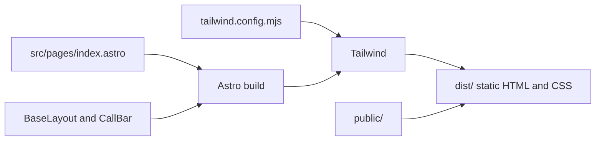

# Architecture

A single-page brochure site for a local air duct cleaning business. It is a static site: every page is rendered to plain HTML at build time, so there is no server, database or runtime to maintain.

## Stack

| Piece | Choice | Why |
| --- | --- | --- |
| Framework | [Astro](https://astro.build) 4.16 | Ships no JavaScript by default, which keeps a content-only site fast |
| Styling | [Tailwind CSS](https://tailwindcss.com) 3.4 | Utility classes sit next to the markup, and the theme lives in one config file |
| Language | Astro components, strict TypeScript config | Typed props on the layout; config extends `astro/tsconfigs/strict` |

## Project structure

```
.
├── public/                  Static files served as-is (favicon)
├── src/
│   ├── components/
│   │   └── CallBar.astro    Sticky "Call" button, mobile only
│   ├── layouts/
│   │   └── BaseLayout.astro Page shell: <head>, meta tags, structured data
│   ├── pages/
│   │   └── index.astro      The home page
│   └── env.d.ts             Pulls in Astro's generated types
├── astro.config.mjs         Astro config: Tailwind integration and site URL
├── tailwind.config.mjs      Theme: brand colors and font stack
├── tsconfig.json            Extends Astro's strict TypeScript preset
└── docs/                    Project documentation
```

## Build flow



`npm run build` renders each page in `src/pages/` to HTML, runs Tailwind over the class names it finds in `src/`, copies `public/` unchanged, and writes the result to `dist/`. Tailwind only includes the classes that are actually used, so the CSS stays small. `dist/` is the folder that gets published. It is not committed to git.

## Page layout

`src/pages/index.astro` wraps everything in `BaseLayout` and renders these blocks from top to bottom:

| Block | Notes |
| --- | --- |
| Header | Sticky; business name and a call button (call button hidden on mobile) |
| Hero | Main heading, call-to-action and anchor link to services |
| Trust strip | Four short claims in a grid |
| Services (`#services`) | Cards generated from the `services` array at the top of the file |
| Call-to-action band | Second prompt to call |
| Contact (`#contact`) | Primary and secondary phone numbers and a service-area note |
| Footer | Business name and copyright (year is computed at build time) |
| `CallBar` | Fixed bottom bar on small screens |

## Layout and component props

`BaseLayout.astro` accepts an optional `Props` object:

| Prop | Type | Default |
| --- | --- | --- |
| `title` | `string` | The business name and tagline |
| `description` | `string` | A one-sentence service description including the phone number |

It sets the document title, meta description, Open Graph tags and a `LocalBusiness` JSON-LD block, then renders the page through `<slot />`. The `<body>` has bottom padding below the `md` breakpoint so the mobile call bar does not cover content.

`CallBar.astro` takes no props. It defines the phone number in a constant at the top of the file.
